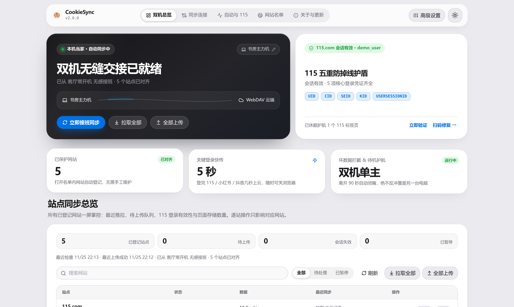
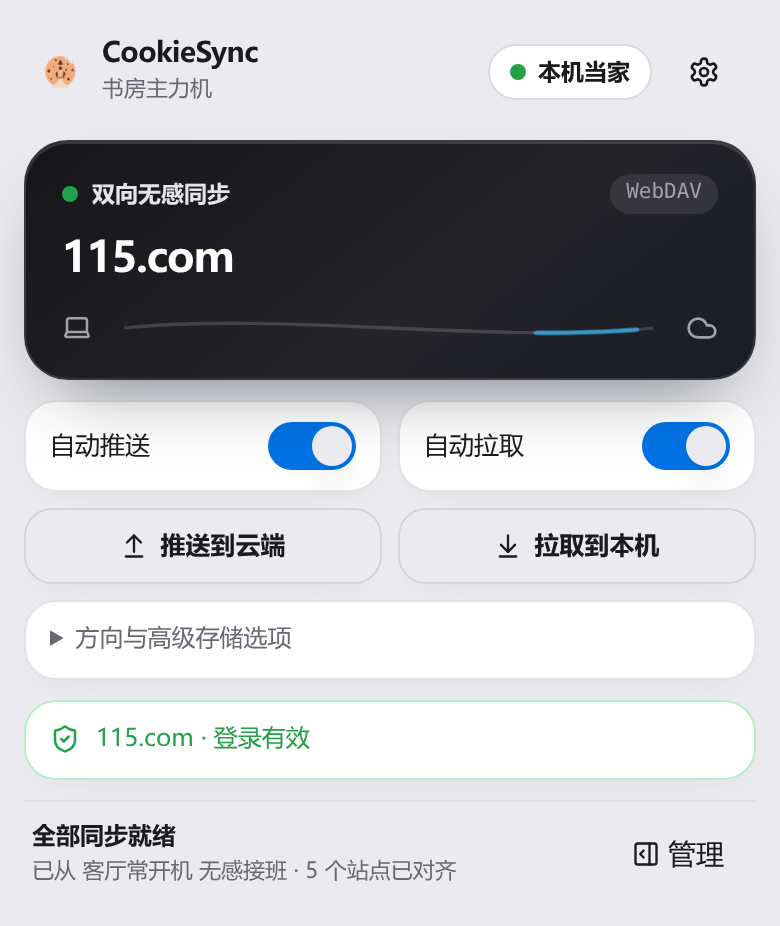
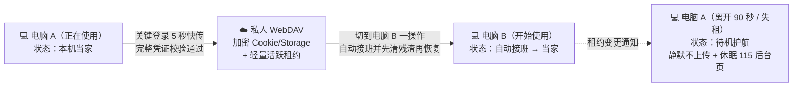

<div align="center">


<h1>CookieSync 2.0</h1>

<p><strong>换电脑，不用重新登录。</strong><br />专为「双机交替使用」「一台常不关机」与「115 防掉线」重构的私人 WebDAV 登录态无感接班扩展。</p>

<p>
  <a href="https://github.com/Xioaruan912/CookieSync/releases/latest">
    
  </a>
  
  
  <a href="LICENSE">
    
  </a>
</p>

<p>
  <a href="#下载与-3-步上手"><strong>下载安装</strong></a> ·
  <a href="#为什么是-20">核心特性</a> ·
  <a href="#双机无感接班如何运作">工作原理</a> ·
  <a href="#钛金精工界面一览">实机界面</a> ·
  <a href="#源码外构建与验证">构建验证</a> ·
  <a href="#安全与隐私">安全隐私</a>
</p>

<br />

<picture>
  <source media="(prefers-color-scheme: dark)" srcset="docs/images/hero-dark.png" />
  <source media="(prefers-color-scheme: light)" srcset="docs/images/hero-light.png" />
  
</picture>

<sub>上方预览自动跟随你的 GitHub 深色 / 浅色外观切换 · 真实 Chromium 渲染截图（使用演示数据）</sub>

</div>

<br />

---

## 为什么是 2.0

如果你在两台电脑之间来回切换（例如一台常年不关机、另一台随开随关），旧式定时互传最容易遇到三个痛点：**不关机的闲置电脑把新登录顶掉**、**115 双端心跳互踢反复掉线**、**刚登完想关浏览器又怕没传上去**。

CookieSync 2.0 从底层存储、同步引擎到前端交互全面重构，把体验收束成三件确定的事：

<table>
  <tr>
    <td width="33.3%" valign="top">
      <h3>双机活跃自动交接</h3>
      <p>自动感知你当前在操作哪台电脑，由正在用的那台<strong>单主接班</strong>：切换电脑自动拉齐最新登录，离开 <strong>90 秒</strong>或另一台开始使用后，闲置机器自动进入<strong>待机护航</strong>并停止回写，绝不拿旧缓存覆盖新登录。</p>
    </td>
    <td width="33.3%" valign="top">
      <h3>随时可关 Chrome</h3>
      <p>不要求一直开着浏览器。登录 <code>115.com</code>、小红书、抖音等重点站点后约 <strong>5 秒</strong>自动快传上云（常规站点 15 秒）；不弹打扰窗、不强开后台页，用完随时关浏览器或关机。</p>
    </td>
    <td width="33.3%" valign="top">
      <h3>115 五重防掉线护盾</h3>
      <p>① 5 项核心登录凭证缺一即拦截不上传；② 恢复前先清冲突旧残渣；③ 不关机电脑待机/失租自动休眠 115 后台标签页防互踢（绝不关闭标签页）；④ 只读会话校验；⑤ 内置官网同款扫码修复。</p>
    </td>
  </tr>
</table>

---

## 钛金精工界面一览

采用 Apple Control Center 风格的 **「钛金精工（Titanium Bento）」** 设计语言，明暗双主题与 **GSAP + ScrollTrigger** 流畅动效贯穿设置页、弹窗与侧边栏：滚动时英雄舞台微景深退隐、毛玻璃顶栏自动停靠并亮出实时角色胶囊、分段导航配备可打断滑动胶囊，并完整遵循 `prefers-reduced-motion`。

<table>
  <tr>
    <td width="38%" align="center" valign="top">
      <picture>
        <source media="(prefers-color-scheme: dark)" srcset="docs/images/popup-dark.png" />
        <source media="(prefers-color-scheme: light)" srcset="docs/images/popup-light.png" />
        
      </picture>
      <br />
      <sub><strong>Control Center 弹窗</strong> · 双向流光状态、一键接班与 115 登录护盾</sub>
    </td>
    <td width="62%" align="center" valign="top">
      
      <br />
      <sub><strong>自动交接与 115 护航</strong> · 顶栏滚动停靠「本机当家」胶囊、单主交接与闲置休眠开关</sub>
    </td>
  </tr>
</table>

---

## 双机无感接班如何运作

两台电脑通过你自己的私人 WebDAV 共享轻量租约文件（`CookieSync-lease-v1.json`）与加密登录态密文（`Protobuf` + 可选 `AES-256-GCM`），同一时间只让当前正在操作的那台写入：



- **智能内容比对**：使用浏览器原生 **SHA-256** 对解密后的语义内容做摘要比对（忽略顺序、时间戳与设备编号），内容未变时跳过远程上传与本地重复写入；两端同时修改时按最新写入时间**新者胜**，并在状态中明确注明采用侧。
- **配置同步三选一**：支持 **Chrome 账号同步**（默认，不含 WebDAV 凭据）、**WebDAV 配置文件**（`CookieSync-config-v1.json`，同步名单与偏好，不含凭据与加密密码）或**关闭**。
- **全生命周期兜底**：内置自动回滚快照点（同步前 / 接班前自动留档）、每日 WebDAV 备份与脱敏诊断导出。

---

## 下载与 3 步上手

### 1. 下载正式安装包

前往 [最新 Releases](https://github.com/Xioaruan912/CookieSync/releases/latest)，下载 Assets 中的 **`CookieSync-chrome-版本号.zip`**（可配合 `SHA256SUMS.txt` 校验）。

> **提示**：GitHub 页面上的 `Code → Download ZIP` 是源码而非安装包。更新时直接解压覆盖原安装目录并在扩展页点击「刷新」，**不要先卸载**，即可完整保留本机配置。

### 2. 在两台电脑分别加载并命名

1. 在 Chrome 打开 `chrome://extensions/`，开启右上角 **开发者模式** → 点击 **加载已解压的扩展程序** → 选择包含 `manifest.json` 的目录。
2. 打开 CookieSync 设置页 → 在「同步连接」填入相同的私人 **HTTPS WebDAV** 地址、账号/应用密码与加密密码（建议两端开启相同 AES-256-GCM 加密）。
3. 点击首页右上角设备名旁的铅笔图标，分别起好分辨的名字（如 `书房主力机` / `客厅常开机`）。

### 3. 开启护航即刻无感同步

- 在「自动与 115」确认默认已勾选 **双机活跃自动交接** 与 **不关机电脑待机/失租时自动休眠 115 后台标签页**。
- 在任意一台电脑登录 `115.com` / 小红书 / 抖音等名单内网站，等待 5 秒上云，换另一台电脑直接打开即可自动保持登录；也可随时在顶部点击 **立即接班同步** 或 **拉取全部** 手动对齐。

<details>
<summary><strong>从旧版本（1.6.x / 1.11.x）升级迁移说明</strong></summary>

- **从 1.6.x 首次升级**：请先备份旧配置与加密密码（固定扩展 ID 的一次性迁移）。
- **从 1.11.x 及之前升级**：GitHub Gist、Cloudflare KV 与 Google Drive Cookie 存储后端已于 1.12.0 移除（云端旧数据保留不动），请配置 WebDAV 后手动推送／拉取各一次完成迁移。
- **更新机制说明**：每天及启动时自动检查 GitHub Releases（支持语义版本升级与同版本新构建号），自动下载并校验安装 ZIP；受 Chrome 扩展沙箱限制，无法全自动覆盖本地解压目录，请按「关于与更新」中的三步指引完成覆盖与重载。更多细节见 [WebDAV 使用说明](docs/WEBDAV.md)。

</details>

---

## 能力边界与诚实说明

- **300 站点精选名单与自定义**：默认仅自动发现 [内置 300 个网站与自定义规则](docs/SITES.md) 内的普通 HTTP(S) 页面，有 Cookie / LocalStorage 即自动登记；名单外旧站点与队列暂停自动收发但不删数据，手动推拉仍可用。
- **存储覆盖范围**：Cookie 与 LocalStorage 默认同步；支持按站点开启 `sessionStorage` 与实验性 `IndexedDB` 同步（受单站体积上限保护）。
- **WebDAV 条件写入**：默认开启 `If-Match / ETag` 条件写入防并发覆盖；AList / OpenList 兼容模式需在高级设置手动开启（其非原子写限制详见 [docs/WEBDAV.md](docs/WEBDAV.md)）。
- **风控诚实边界**：Cookie 过期、服务端主动撤销会话或目标站设备风控仍可能要求重新验证登录，扩展不承诺绕过任何服务端风控；115 提供只读有效性校验与隐藏扫码修复入口。所有自动化测试均基于虚拟数据，未使用真实账号。

---

## 源码外构建与验证

需要 **Node.js 20.12+**（见 `.nvmrc`）与 **pnpm 9.1.1**。仓库保持纯源码，依赖与编译缓存自动隔离在系统临时目录，成品输出至同级 `../CookieSync-release/`：

```sh
# 完整编译、类型检查、全量单元测试与打包校验
node scripts/workspace.mjs verify

# 对已验证源码仅快速打包（产物位于 ../CookieSync-release/）
node scripts/workspace.mjs build
```

每次推送至 `main`，GitHub Actions 会自动执行 `verify` 并将通过校验的安装 ZIP 与 `SHA256SUMS.txt` 发布到 Releases（标签 `v版本号-build.构建号`）。

<details>
<summary><strong>重构后的项目架构一览</strong></summary>

| 目录 | 职责说明 |
| :--- | :--- |
| `chrome-extension/lib/background/activeDevice/` | 双机活跃监测（`chrome.idle` + 窗口焦点）、云端单主租约管理与 115 闲置标签休眠护航 |
| `chrome-extension/lib/background/sync/` | 统一站点发现、快传防抖捕获、云端比对调和与单站/批量接班管线 |
| `chrome-extension/lib/background/` | 统一消息路由（`router.ts`）、角标状态机（`badgeController.ts`）、健康巡检与安全回滚 |
| `packages/shared/lib/` | WebDAV 客户端与租约读写、Clean-Before-Write 恢复内核、115 等站点登录档案与语义指纹 |
| `packages/storage/lib/` | 串行防竞争持久化存储层、设备身份与同步运行时状态 |
| `pages/{options,popup,sidepanel}/` | 钛金精工前端（React 18 + Tailwind + GSAP ScrollTrigger） |
| `pages/content/src/` | 瘦身版页面存储桥与变更监听（无轮询、按名单事件驱动） |
| `docs/` | [WebDAV 深度配置与排错](docs/WEBDAV.md) · [内置 300 站点目录](docs/SITES.md) |

</details>

---

## 安全与隐私

- Cookie 与 LocalStorage 等同于网站登录凭据，请务必使用**私人 HTTPS WebDAV** 与专用应用密码，并在所有设备启用一致的 **AES-256-GCM 数据加密**（Protobuf / Base64 编码本身不提供加密）。
- WebDAV 凭据默认仅保留在本机，绝不写入 `CookieSync-config-v1.json`，也绝不打印任何 Cookie / 令牌明文日志；详见 [隐私说明](PRIVACY.md) 与 [安全与配置文档](docs/WEBDAV.md)。

---

## 致谢与许可证

本项目基于 [jackluson/sync-your-cookie](https://github.com/jackluson/sync-your-cookie) 二次开发，采用 **[MIT 许可证](LICENSE)**，完整保留原作者 **Jack Lu** 的版权声明。
