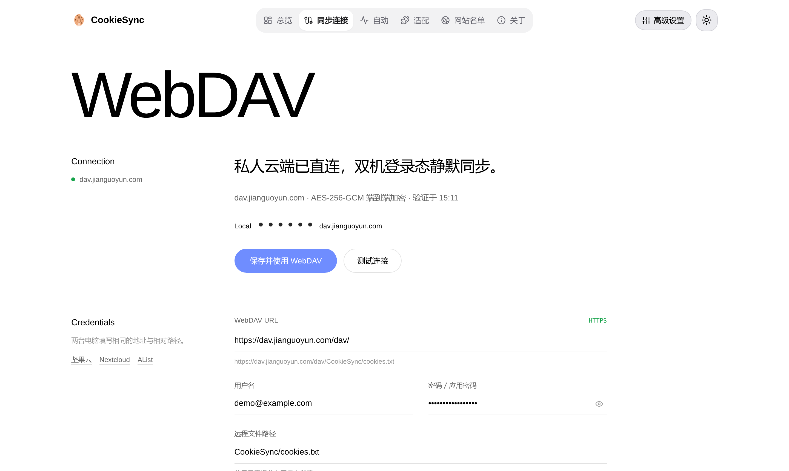
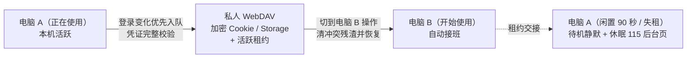

<div align="center">

<br />


<h1>CookieSync</h1>

<p><strong>换电脑，不用重新登录。</strong><br />专为双机交替使用、常不关机与 115 防掉线打造的私人 WebDAV 登录态同步扩展。</p>

<p>
  <a href="https://github.com/Xioaruan912/CookieSync/releases/latest"><strong>下载 v2.0.0</strong></a> &nbsp;·&nbsp;
  <a href="#核心能力">核心能力</a> &nbsp;·&nbsp;
  <a href="#界面预览">界面预览</a> &nbsp;·&nbsp;
  <a href="#快速开始">快速开始</a> &nbsp;·&nbsp;
  <a href="#构建与验证">构建验证</a> &nbsp;·&nbsp;
  <a href="#安全与隐私">安全隐私</a>
</p>

<br />

<picture>
  <source media="(prefers-color-scheme: dark)" srcset="docs/images/connection-dark.png" />
  <source media="(prefers-color-scheme: light)" srcset="docs/images/connection-light.png" />
  
</picture>

<sub>实机渲染截图 · 自动跟随 GitHub 浅色 / 深色外观切换</sub>

</div>

<br />

---

## 核心能力

<table>
  <tr>
    <td width="33.3%" valign="top">
      <h3>双机活跃自动交接</h3>
      <p>自动识别你正在使用哪台电脑，由当前活跃机<strong>单主接班</strong>；离开 <strong>90 秒</strong>或另一台接管后，闲置电脑自动静默，绝不拿旧缓存覆盖新登录。</p>
    </td>
    <td width="33.3%" valign="top">
      <h3>登录快传，随时关浏览器</h3>
      <p>关键登录变化约 <strong>1 秒</strong>内优先发起同步（常规约 4 秒），关闭网页前自动补采最后改动；完全退出后，队列在下次打开浏览器时续传。</p>
    </td>
    <td width="33.3%" valign="top">
      <h3>115 五重防掉线护盾</h3>
      <p>① 缺核心凭证自动拦截不上传；② 恢复前先清冲突旧 Cookie；③ 闲置待机自动休眠 115 后台标签页防互踢（绝不关闭标签页）；④ 只读会话校验；⑤ 内置扫码修复。</p>
    </td>
  </tr>
</table>

---

## 界面预览

<picture>
  <source media="(prefers-color-scheme: dark)" srcset="docs/images/hero-dark.png" />
  <source media="(prefers-color-scheme: light)" srcset="docs/images/hero-light.png" />
  
</picture>

<br />

<table>
  <tr>
    <td width="36%" align="center" valign="top">
      <picture>
        <source media="(prefers-color-scheme: dark)" srcset="docs/images/popup-dark.png" />
        <source media="(prefers-color-scheme: light)" srcset="docs/images/popup-light.png" />
        
      </picture>
      <br />
      <sub><strong>快捷弹窗</strong> · 一键接班、逐站开关与 115 状态</sub>
    </td>
    <td width="64%" align="center" valign="top">
      
      <br />
      <sub><strong>自动同步</strong> · 开关控制、三步流程状态、超限复查与回滚诊断</sub>
    </td>
  </tr>
</table>

---

## 工作原理

两台电脑通过你自己的私人 WebDAV 共享轻量租约（`CookieSync-lease-v1.json`）与加密数据（`Protobuf` + 可选 `AES-256-GCM`），同一时间只让当前正在操作的那台写入：



- **语义摘要比对**：使用浏览器原生 **SHA-256** 比对解密后的语义内容（忽略顺序、时间戳与设备编号），未变化直接跳过；两端同时改动时按写入时间**新者胜**。
- **配置同步三选一**：支持 **Chrome 账号**（默认，不含 WebDAV 密码）、**WebDAV 配置文件**（`CookieSync-config-v1.json`，不含凭据与加密密码）或**仅本机**。
- **安全兜底**：同步前 / 接班前自动留存回滚点、每日 WebDAV 备份、存储超限逐 origin 明细复查与脱敏诊断导出。

---

## 快速开始

1. **下载安装包**：前往 [最新 Releases](https://github.com/Xioaruan912/CookieSync/releases/latest) 下载 `CookieSync-chrome-版本号.zip`（可配合 `SHA256SUMS.txt` 校验；`Code → Download ZIP` 是源码，不可直接加载）。
2. **加载扩展**：打开 `chrome://extensions/` → 开启开发者模式 → 加载解压后的目录（更新时直接覆盖原目录并点「刷新」，**不要先卸载**，即可保留配置）。
3. **连接 WebDAV**：在两台电脑的「同步连接」填入相同私人 HTTPS WebDAV 地址、账号/应用密码与相对路径，点击「测试连接」通过后保存；在「自动」确认开启 **双机自动交接**，在「适配」确认开启 **待机时休眠单会话网站**。

<details>
<summary><strong>旧版本迁移与更新机制说明</strong></summary>

- **从 1.6.x 首次升级**：请先备份旧配置与加密密码（固定扩展 ID 的一次性迁移）。
- **从 1.11.x 及之前升级**：GitHub Gist、Cloudflare KV 与 Google Drive Cookie 后端已于 1.12.0 移除（云端旧数据保留不动），配置 WebDAV 后手动推拉各一次即可完成迁移。
- **自动检查更新**：每天及启动时检查 GitHub Releases（识别更高语义版本或带构建号的新构建；未标注构建号的本地包仅在出现更高版本时提示），自动下载并校验 ZIP；受 Chrome 沙箱限制，仍需按三步指引覆盖解压目录并重新加载。详见 [WebDAV 使用说明](docs/WEBDAV.md)。

</details>

---

## 能力边界

- **300 站点精选名单**：默认仅自动发现 [内置 300 个网站与自定义规则](docs/SITES.md) 内的普通 HTTP(S) 页面；名单外旧站点暂停自动收发但不删数据，手动推拉仍可用。
- **存储覆盖**：默认同步 Cookie 与 LocalStorage；支持按站点开启 `sessionStorage` 与实验性 `IndexedDB`（受体积上限保护并可复查超限明细）。
- **条件写入**：默认开启 `If-Match / ETag` 防并发覆盖；AList / OpenList 兼容模式需在「高级与兼容选项」手动开启（详见 [docs/WEBDAV.md](docs/WEBDAV.md)）。
- **风控说明**：Cookie 过期、服务端撤销会话或设备风控仍可能要求重新登录，扩展不承诺绕过任何服务端风控；所有测试均使用虚拟数据，未涉及真实账号。

---

## 构建与验证

需要 **Node.js 20.12+**（见 `.nvmrc`）与 **pnpm 9.1.1**。仓库保持纯源码，依赖与缓存隔离在系统临时目录，安装包输出至同级 `../CookieSync-release/`：

```sh
# 完整编译、类型检查、全量单元测试与打包校验
node scripts/workspace.mjs verify

# 仅快速打包已验证源码
node scripts/workspace.mjs build
```

每次推送至 `main`，GitHub Actions 自动运行 `verify` 并将通过校验的安装 ZIP 与 `SHA256SUMS.txt` 发布到 Releases。

<details>
<summary><strong>项目目录结构</strong></summary>

| 目录 | 职责 |
| :--- | :--- |
| `chrome-extension/lib/background/activeDevice/` | 活跃监测、单主租约管理、115 闲置标签页休眠护航 |
| `chrome-extension/lib/background/sync/` | 站点发现、1s/4s 快传捕获、云端调和、批量接班与存储上限复查 |
| `packages/shared/lib/` | WebDAV 客户端与租约、Clean-Before-Write 恢复、站点登录档案与语义指纹 |
| `packages/storage/lib/` | 串行防竞争持久化存储、设备身份与运行时诊断状态 |
| `pages/{options,popup,sidepanel}/` | 6 分区设置页（含极简画廊风同步连接）、快捷弹窗与侧边栏 |
| `pages/content/src/` | 轻量页面存储桥与切后台/关页最终捕获 |
| `docs/` | [WebDAV 深度说明](docs/WEBDAV.md) · [内置 300 站点名单](docs/SITES.md) |

</details>

---

## 安全与隐私

Cookie 与 LocalStorage 等同于登录凭据。请使用**私人 HTTPS WebDAV** 与专用应用密码，并在所有设备启用一致的 **AES-256-GCM 端到端加密**。WebDAV 凭据默认仅存本机，不写入 `CookieSync-config-v1.json`，不打印任何敏感明文日志；详见 [隐私说明](PRIVACY.md)。

---

## 许可证与致谢

基于 [jackluson/sync-your-cookie](https://github.com/jackluson/sync-your-cookie) 二次开发，采用 **[MIT 许可证](LICENSE)**，完整保留原作者 **Jack Lu** 的版权声明。
