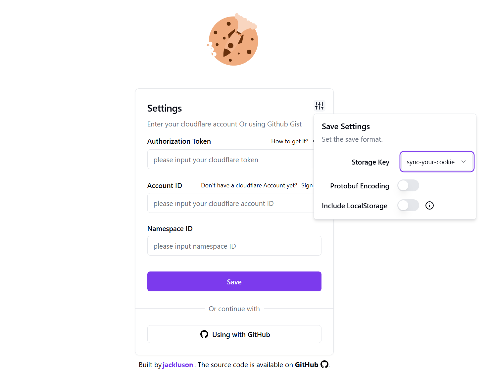
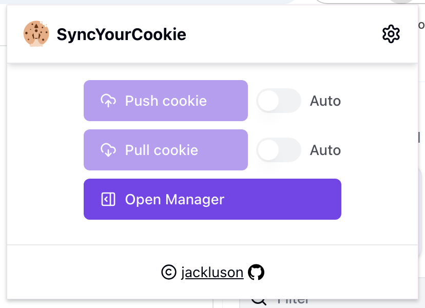
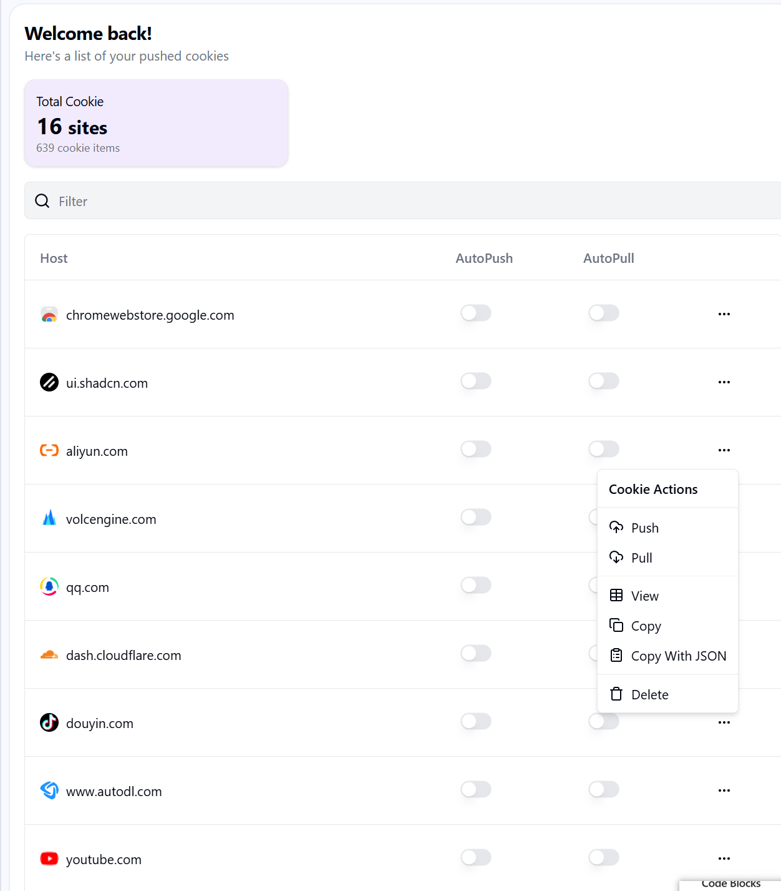
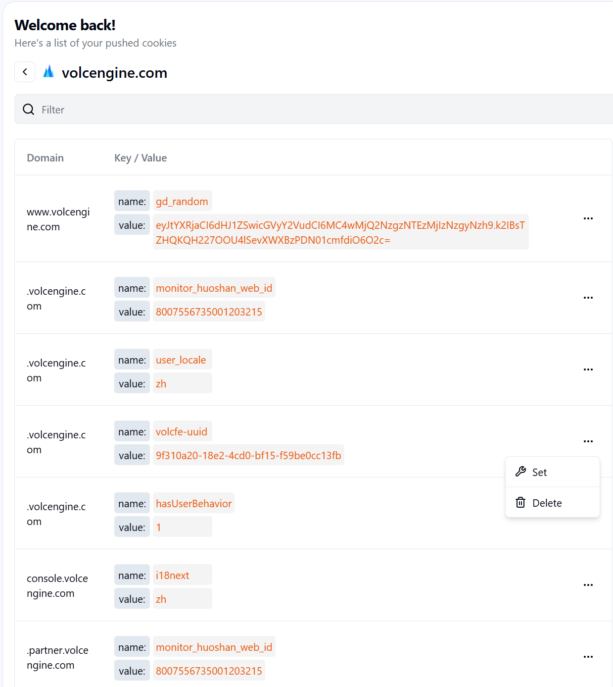
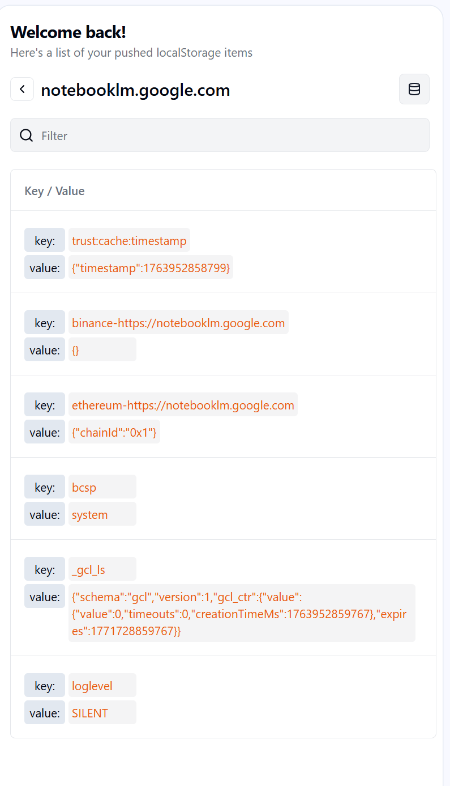
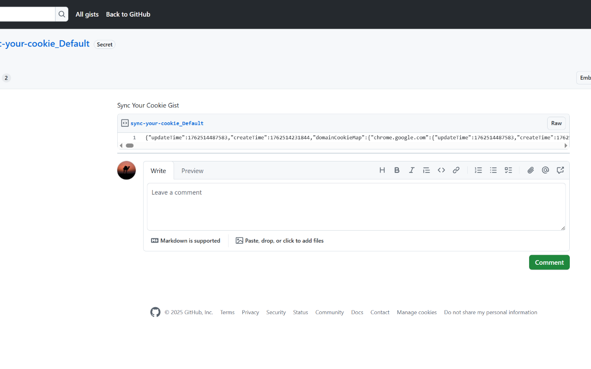
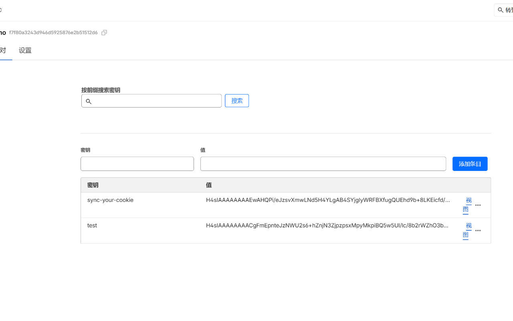
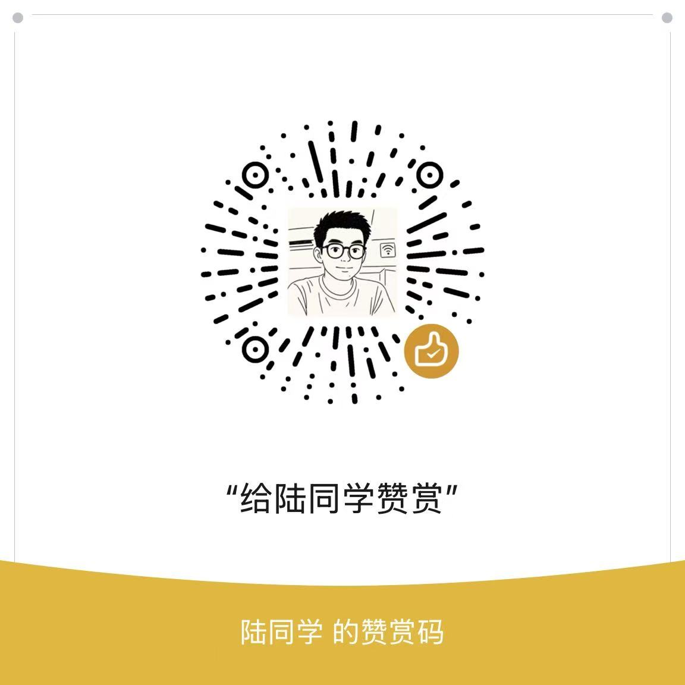

# CookieSync · WebDAV 与简体中文分支

基于 [jackluson/sync-your-cookie](https://github.com/jackluson/sync-your-cookie) 的 MIT 二次开发版本。新增 WebDAV 同步配置、连接测试和后端，汉化设置、弹窗与管理侧栏，保留 Cloudflare KV 与 GitHub Gist。

- WebDAV URL、用户名、密码／应用密码、远程文件路径；凭据仅保存本机。
- 手动推送、拉取并应用、按网站合并；增加浏览器启动自动拉取、后台增量同步与本机离线队列（默认每 2 分钟合并，无关闭钩子）。
- HTTPS、超时、防重定向、ETag 条件写；连接测试使用独立临时文件。
- 继续支持原有 Protobuf 编码、LocalStorage 和可选 AES-256-GCM 加密。
- 小红书、抖音、115 主域及子域 Cookie 优先处理，修复会话 Cookie 误设过期时间。

安装、配置、合并规则、自动同步限制与安全风险见 **[WebDAV 使用说明](docs/WEBDAV.md)**。

```sh
pnpm install --frozen-lockfile
pnpm build
pnpm type-check
pnpm test
```

Chrome 开发者模式中加载根目录 `dist/`。不要将依赖、构建目录、浏览器资料或真实 Cookie / 密码提交到 GitHub。Cookie 同步不能保证绕过小红书、抖音等网站的设备风控或重新验证。

以下保留原项目说明及作者信息。

---

<div align="center">

<h1> Sync your cookie to Your Cloudflare or Github Gist</h1>


<!--  -->

</div>

[English](./README.md) | [中文](./README_ZH.md)

`Sync your cookie` is a chrome extension that helps you to sync your cookie to Cloudflare or Github Gist. It's a useful tool for web developers to share cookies between different devices. 

### Install
Chrome: [Sync Your Cookie](https://chromewebstore.google.com/detail/sync-your-cookie/bcegpckmgklcpcapnbigfdadedcneopf)

Edge: [Sync Your Cookie](https://microsoftedge.microsoft.com/addons/detail/sync-your-cookie/ohlcghldllgnmkegocpcphdbbphikgfm)


### Features

- Supports syncing cookies to Cloudflare or Github Gist (Include LocalStorage)
- Supports configuring `Auto Merge` and `Auto Push` rules for different sites
- Cookie data is transmitted via protobuf encoding
- Provides a management panel to facilitate viewing, copying, and managing synchronized cookie data
- Multi-account synchronization based on Storage-key


### Project Screenshots

Account Settings Page



Cookie Sync Popup Page



Cookie Manager Sidebar Panel



Cookie Detail



LocalStorage Detail



Pushed Cookie on Github Gist




Pushed Cookie on Cloudflare




### Usage

[How to use](./how-to-use.md)

### TODO

- [x] Custom Save Configure
- [x] Multi-account synchronization based on Storage-key
- [x] Sync LocalStorage
- [x] More Cloud Platform (First github gist)

### Privacy Policy

Please refer to [Privacy Policy](./private-policy.md) for more information.

### Support

If you find this project helpful, you can support the development by:
- Starring the repository ⭐
- [Sponsoring via Ko-fi](https://ko-fi.com/jacklu) 💖
- Sponsor via Wechat
  <div>
    
  </div>
- Sharing it with others 🚀
