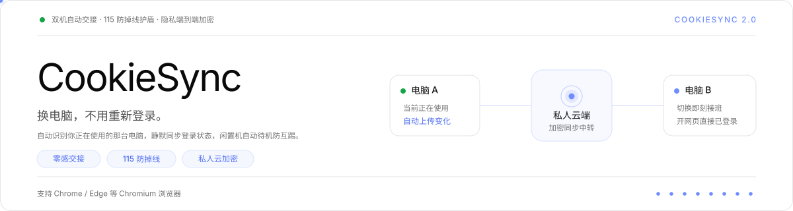
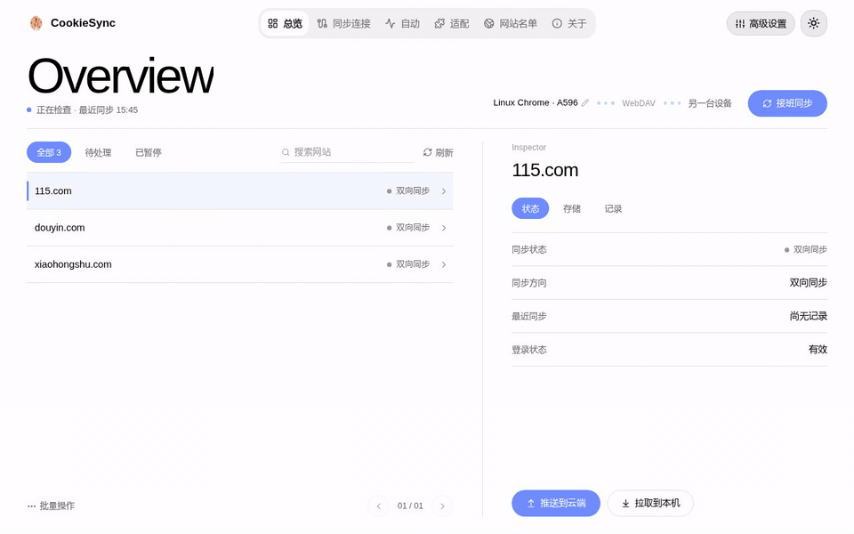
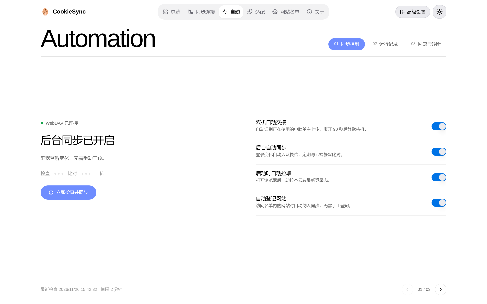

<div align="center">

<picture>
  <source media="(prefers-color-scheme: dark)" srcset="docs/images/hero-banner-dark.svg" />
  <source media="(prefers-color-scheme: light)" srcset="docs/images/hero-banner-light.svg" />
  
</picture>

<br />

<p>
  <a href="https://github.com/Xioaruan912/CookieSync/releases/latest"><strong>下载最新版</strong></a> &nbsp;·&nbsp;
  <a href="#界面动效预览">界面预览</a> &nbsp;·&nbsp;
  <a href="#3-步上手">3 步上手</a> &nbsp;·&nbsp;
  <a href="#为什么好用">为什么好用</a> &nbsp;·&nbsp;
  <a href="#开发者与-ai-二次开发">开发者 / AI 提示词</a> &nbsp;·&nbsp;
  <a href="https://ifdian.net/a/ppeea"><strong>⚡ 爱发电赞助</strong></a>
</p>

</div>

---

## 为什么好用

<table>
  <tr>
    <td width="33.3%" valign="top">
      <h3>换电脑，自动接班</h3>
      <p>自动识别你当前正在使用哪台电脑，由正在用的这台负责上传；离开超过 <strong>90 秒</strong>或切到另一台后，闲置电脑自动静默，绝不拿旧记录覆盖新登录。</p>
    </td>
    <td width="33.3%" valign="top">
      <h3>刚登录就同步，随时关网页</h3>
      <p>新登录的网站几秒内自动加密备份到你的私人网盘；关闭网页前还会补传最后一次改动，没变化时自动跳过，省心不打扰。</p>
    </td>
    <td width="33.3%" valign="top">
      <h3>115 专属防掉线护盾</h3>
      <p>针对容易多端互踢的 115 网盘做了专门保护：闲置电脑自动休眠后台标签页防止挤下线（绝不关闭你的网页），状态异常时内置官网同款扫码一键修复。</p>
    </td>
  </tr>
</table>

<br />

<picture>
  <source media="(prefers-color-scheme: dark)" srcset="docs/images/handover-flow-dark.svg" />
  <source media="(prefers-color-scheme: light)" srcset="docs/images/handover-flow-light.svg" />
  
</picture>

---

## 界面动效预览

<div align="center">
  
  <br />
  <sub>实机录制 · 零竖滚横向画廊（总览 · 同步连接 · 自动 · 适配）</sub>
</div>

<br />

<table>
  <tr>
    <td width="36%" align="center" valign="top">
      <picture>
        <source media="(prefers-color-scheme: dark)" srcset="docs/images/popup-dark.png" />
        <source media="(prefers-color-scheme: light)" srcset="docs/images/popup-light.png" />
        
      </picture>
      <br />
      <sub><strong>快捷弹窗</strong> · 一键切换主机与逐站开关</sub>
    </td>
    <td width="64%" align="center" valign="top">
      
      <br />
      <sub><strong>自动同步</strong> · 极简开关、运行记录与安全回滚</sub>
    </td>
  </tr>
</table>

---

## 3 步上手

1. **下载安装包**：打开 [最新 Releases](https://github.com/Xioaruan912/CookieSync/releases/latest)，下载 `CookieSync-chrome-版本号.zip` 并解压（不要点网页上的 `Code → Download ZIP`，那是源码）。
2. **装进浏览器**：打开 `chrome://extensions/` → 右上角打开「开发者模式」→ 点击「加载已解压的扩展程序」选中刚解压的文件夹。
   > 更新版本时，直接把新解压的文件覆盖原文件夹，再点扩展卡片上的「刷新」即可，**不要先卸载**，所有配置都会保留。
3. **连上你的私人网盘**：在两台电脑的「同步连接」里填入相同的私人网盘地址与账号密码（支持坚果云等常见 WebDAV 网盘），点「测试连接」通过后保存即可开始自动同步。

---

## 隐私与安全

- **数据只存在你自己的网盘**：扩展不经过任何第三方中转服务器，所有登录数据只保存在你自己配置的私人网盘里。
- **支持端到端加密**：在两台电脑设置一致的加密密码后，上传到网盘的内容均为密文；网盘密码默认仅保存在本机。
- **安全兜底**：每次同步或换机接班前自动留存回滚点，误操作可一键还原。更多说明见 [隐私说明](PRIVACY.md)。

> 提示：网站本身的登录过期或账号安全风控属于网站服务端行为，扩展不会、也无法绕过任何网站风控。

---

## 开发者与 AI 二次开发

> 以下内容面向开发者与进阶用户，普通使用无需展开。

<details>
<summary><strong>AI 二次开发提示词（直接复制给 Cursor / Claude / Codex / Antigravity）</strong></summary>

<br />

将下面的项目上下文直接粘贴到你的 AI 编程工具中，即可让 AI 在不破坏现有架构与安全约束的前提下帮你定制功能：

```markdown
你正在二次开发 CookieSync（Chrome / Chromium 登录态同步扩展，仓库根目录为唯一源码真相）。
请严格遵守以下项目约定：

1. 纯源码仓库与构建方式
   - 禁止在仓库内提交 node_modules、dist、build、.turbo、ZIP 或真实凭据。
   - 唯一验证与构建命令：`node scripts/workspace.mjs verify`（快速打包用 `node scripts/workspace.mjs build`），产物输出到同级 `../CookieSync-release/`。
   - 不要引入需要常驻后台的开发热更新服务器；修改后通过打包产物在 Chrome 加载验证。

2. 核心架构红线
   - 登录数据（Cookie / LocalStorage）仅通过 WebDAV 传输，不要重新引入 Gist / KV / Google Drive 等已移除后端。
   - 保持 `chrome-extension/google-config.json` 中的公钥稳定，切勿修改（会影响跨设备扩展 ID）。
   - 自动发现仅作用于内置 300 站点名单与用户自定义规则；名单外站点暂停自动收发但不删除数据。
   - 语义比对基于解密后的内容摘要（SHA-256），忽略顺序、时间戳和设备 ID；双端同时改动时按写入时间新者胜。
   - 站点专属健康检查（`packages/shared/lib/siteProfiles`）必须使用只读接口，严禁调用会踢掉其他设备的 SSO 接口。
   - 严禁在日志中打印 Cookie、Token 或任何明文密码；保留 MIT 许可证与原作者 Jack Lu 署名。

3. 前端视觉规范（Options 设置页）
   - 遵循极简零竖滚横向画廊风格（纯白 `#FFFFFF` / 纯黑 `#000000` 画布、`1px` 极细分割线、轻量大字标、`#6F8DFF` 主色胶囊按钮、桌面端 `100dvh` 零竖滚 + 横向分页切换），避免灰框卡片堆砌与多余阴影。

请先阅读你要修改的模块文件，再按以上约束实现需求，最后运行 `node scripts/workspace.mjs verify` 确认全部编译与单元测试通过。
```

**常用快捷任务指令（可接在上面的上下文后面）：**
- **新增一个防踢网站适配**：`请在 packages/shared/lib/siteProfiles 新增 <目标域名> 的只读登录校验配置，并在 #adaptations 页面支持切换查看与状态检测，最后运行 verify 并补充单元测试。`
- **重构其余设置页样式**：`请按照 #connection / #automation 的零竖滚横向画廊风格重构 #sites（或 #about）页面，保持明暗双主题与移动端适配，最后用真实浏览器截图检查并运行 verify。`
- **调整同步策略**：`请修改双机活跃接班的闲置阈值 / 站点同步行为，确保保留回滚点与冲突保护，并补充对应的单测。`

</details>

<details>
<summary><strong>本地构建与目录结构</strong></summary>

<br />

需要 **Node.js 20.12+**（见 `.nvmrc`）与 **pnpm 9.1.1**。依赖与缓存隔离在系统临时目录，安装包输出至同级 `../CookieSync-release/`：

```sh
# 完整编译、类型检查、全量单元测试与打包校验
node scripts/workspace.mjs verify

# 仅快速打包已验证源码
node scripts/workspace.mjs build
```

| 目录 | 职责 |
| :--- | :--- |
| `chrome-extension/lib/background/activeDevice/` | 双机活跃监测、单主租约交接、单会话标签页闲置休眠 |
| `chrome-extension/lib/background/sync/` | 站点发现、1s/4s 快传捕获、云端调和、接班恢复与超限复查 |
| `packages/shared/lib/` | WebDAV 客户端、Clean-Before-Write 恢复、站点登录档案与语义指纹 |
| `packages/storage/lib/` | 串行防竞争持久化存储、设备身份与运行时诊断状态 |
| `pages/{options,popup,sidepanel}/` | 设置页（零竖滚横向画廊）、快捷弹窗与侧边栏 |
| `pages/content/src/` | 轻量页面存储桥与切后台/关页补采 |
| `docs/` | [WebDAV 进阶说明](docs/WEBDAV.md) · [内置 300 站点名单](docs/SITES.md) |

</details>

<details>
<summary><strong>进阶说明：技术特性、旧版本迁移与自动更新</strong></summary>

<br />

- **协议与存储细节**：使用 Protobuf 序列化 + 可选 AES-256-GCM 端到端加密；默认同步 Cookie 与 LocalStorage，可按站开启 `sessionStorage` 与实验性 `IndexedDB`（带体积上限保护与逐 origin 超限明细）；默认开启 `If-Match / ETag` 条件写入防并发覆盖（AList / OpenList 兼容模式可在高级设置中手动开启，详见 [docs/WEBDAV.md](docs/WEBDAV.md)）。
- **配置同步通道**：默认随 Chrome 账号同步（不含 WebDAV 密码），也可改用 WebDAV 配置文件（`CookieSync-config-v1.json`，不含凭据与加密密码）或仅存本机。
- **内置名单**：默认仅自动发现 [内置 300 个网站](docs/SITES.md) 与自定义规则内的页面，名单外旧站点暂停自动收发但不删数据。
- **旧版本迁移**：
  - 从 `1.6.x` 首次升级：请先备份旧配置与加密密码（固定扩展 ID 的一次性迁移）。
  - 从 `1.11.x` 及之前升级：GitHub Gist、Cloudflare KV 与 Google Drive 后端已移除（旧数据保留不动），配置 WebDAV 后手动推拉各一次即可完成迁移。
- **更新检查**：每日及启动时自动检查 GitHub Releases，发现新版本或新构建后自动下载并校验安装包；受浏览器安全机制限制，仍需按指引覆盖原目录并刷新扩展。

</details>

---

## 赞助支持

如果 CookieSync 帮你省下了反复扫码登录的时间，欢迎通过爱发电请作者喝杯咖啡，支持项目持续维护与免费开源：

<a href="https://ifdian.net/a/ppeea" target="_blank" rel="noreferrer">
  
</a>

> 所有赞助均为自愿支持，CookieSync 全部功能保持完全开源免费。

---

## 许可证与致谢

基于 [jackluson/sync-your-cookie](https://github.com/jackluson/sync-your-cookie) 二次开发，采用 **[MIT 许可证](LICENSE)**，完整保留原作者 **Jack Lu** 的版权声明。
